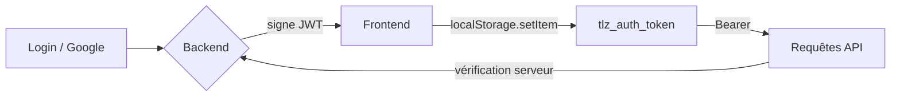
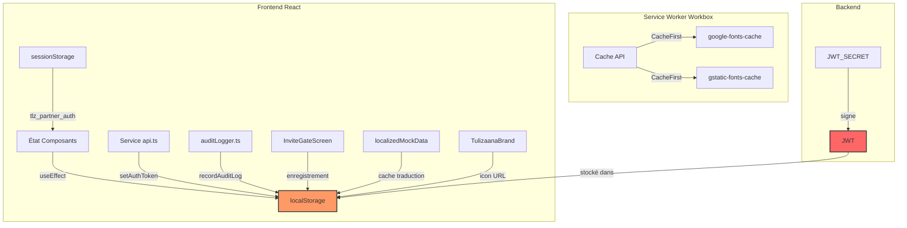

# Audit Sécurité Navigateur — Chantier 6
## Tulizaana — Inventaire, Classification et Plan de Remédiation

**Date :** 2026-10-04  
**Portée :** Frontend React (Vite + PWA) + Service Worker  
**Règle d'or :** Aucune modification de code pendant cette phase — audit uniquement.

---

## 1. Résumé Exécutif

L'application Tulizaana utilise massivement `localStorage` comme cache d'état applicatif, sans mécanisme d'isolation par utilisateur ni de purge systématique à la déconnexion. Le jeton JWT d'authentification (`tlz_auth_token`) est stocké en clair dans `localStorage`, ce qui expose l'ensemble du compte à tout vol de jeton via XSS. Le composant d'audit admin embarque des données factices mais réalistes (PII, adresses IP, détails santé) en `localStorage`, créant un risque de confusion et de fuite accidentelle. Le service worker (Workbox) ne met en cache que des polices Google en `CacheFirst`, ce qui est acceptable.

**Risque global : ÉLEVÉ**  
**Priorité 1 (immédiate) :** Déconnexion incomplète + JWT dans `localStorage`.  
**Priorité 2 (court terme) :** Isolation des caches, suppression des PII factices, revue du scope des variables d'environnement exposées au frontend.  
**Priorité 3 (moyen terme) :** Migration vers un store applicatif sérialisé (ex. Redux/Zustand) avec politiques de purge centralisées.

---

## 2. Inventaire Complet des Mécanismes de Stockage Navigateur

### 2.1 localStorage

| Clé | Fichier(s) | Type de donnée | Lecture | Écriture | Description |
|---|---|---|---|---|---|
| `tlz_auth_token` | `src/services/api.ts` | JWT Bearer | `getAuthToken()` | `setAuthToken()` | Token d'authentification natif |
| `tlz_is_logged_in` | `src/App.tsx` | booléen | `useState` init | login/logout | État de connexion |
| `tlz_interface_mode` | `src/App.tsx` | `'user'` \| `'partner'` | `useState` init | changement mode | Mode d'interface |
| `tlz_partner_auth` | `src/App.tsx` | booléen (legacy) | — | logout | Marqueur partenaire historique |
| `tlz_current_user` | `src/App.tsx` | `UserProfile` | `useState` init | multiples | Profil utilisateur courant |
| `tlz_all_users` | `src/App.tsx` | `UserProfile[]` | `useState` init | mise à jour admin | Référentiel utilisateurs |
| `tlz_organizations` | `src/App.tsx` | `Organization[]` | `useState` init | CRUD | Cache organisations |
| `tlz_current_organization` | `src/App.tsx` | `Organization` | `useState` init | sélection | Organisation courante |
| `tlz_posts` | `src/App.tsx` | `Post[]` | `useState` init | CRUD | Cache publications |
| `tlz_stories` | `src/App.tsx` | `StoryTestimonial[]` | `useState` init | — | Cache témoignages |
| `tlz_campaigns` | `src/App.tsx` | `Campaign[]` | `useState` init | CRUD | Cache campagnes |
| `tlz_communities` | `src/App.tsx` | `Community[]` | `useState` init | CRUD | Cache communautés |
| `tlz_threads` | `src/App.tsx` | `MessageThread[]` | `useState` init | messaging | Cache messages |
| `tlz_invitations` | `src/App.tsx` | `InvitationCode[]` | `useState` init | création | Codes invitation |
| `tlz_reports` | `src/App.tsx` | `ModerationReport[]` | `useState` init | modération | Signalements |
| `tlz_notifications` | `src/App.tsx` | `AppNotification[]` | `useState` init | — | Notifications |
| `tlz_invitation_requests` | `src/App.tsx` | `MemberInvitationRequest[]` | `useState` init | CRUD | Demandes adhésion |
| `tlz_admin_audit_logs` | `src/utils/auditLogger.ts` | `AuditLog[]` | `getStoredAuditLogs()` | `recordAuditLog()` | Logs admin (données factices) |
| `tlz_registered_users` | `src/components/onboarding/InviteGateScreen.tsx` | `{email,passwordHash?,name,role,createdAt}[]` | lecture onboarding | inscription | Comptes enregistrés localement |
| `tlz_user_post_translations` | `src/data/localizedMockData.ts` | `Record<string,Record<string,DynamicPostTranslation>>` | `loadUserPostCache()` | `persistUserPostCache()` | Cache traduction posts |
| `tlz_custom_brand_icon` | `src/components/brand/TulizaanaBrand.tsx` | `string` (URL) | `getPublishedBrandIcon()` | `publishBrandIcon()` | Icone marque |

### 2.2 sessionStorage

| Clé | Fichier(s) | Description |
|---|---|---|
| `tlz_partner_auth` | `src/App.tsx` | Marqueur partenaire (legacy, lecture dans `useState`, suppression au logout) |

### 2.3 Cache API (Service Worker / Workbox)

| Cache | Fichier | Durée | Contenu |
|---|---|---|---|
| `google-fonts-cache` | `vite.config.ts` | 1 an | Polices Google Fonts |
| `gstatic-fonts-cache` | `vite.config.ts` | 1 an | Polices gstatic |

Le service worker est enregistré uniquement en production (`src/main.tsx`, ligne 8) via `registerSW({ immediate: true })`. Aucune autre ressource API n'est mise en cache.

### 2.4 Cookies

Aucune utilisation de cookies détectée dans le frontend.

### 2.5 IndexedDB

Aucune utilisation d'IndexedDB détectée.

### 2.6 Variables d'Environnement Frontend

`vite.config.ts` ligne 96 :
```ts
envPrefix: ['VITE_', 'NEXT_PUBLIC_', 'SUPABASE_', 'POSTGRES_']
```

Les variables préfixées par `SUPABASE_` et `POSTGRES_` sont exposées au bundle frontend. Si des valeurs réelles sont présentes dans l'environnement de build, elles seront lisibles dans le code source de l'application compilée.

---

## 3. Classification des Données par Sensibilité

### 3.1 CRITIQUE — Doit être chiffré / protégé par HttpOnly / durée de vie minimale

| Clé | Justification |
|---|---|
| `tlz_auth_token` | JWTBearer. Vol = prise de contrôle totale du compte. |
| `tlz_current_user` | Contient nom, email, rôle, bio, photo, savedPostIds. |
| `tlz_threads` | Messages privés — contenu santé mentale. |

### 3.2 SENSIBLE — Accès restreint, pas de persistance longue sans consentement

| Clé | Justification |
|---|---|
| `tlz_admin_audit_logs` | Contient PII factice mais réaliste (noms, IPs, détails santé). |
| `tlz_registered_users` | Stocke les identifiants de connexion locaux (email + hash simulé). |
| `tlz_reports` | Signalements modération — contenu utilisateur sensible. |
| `tlz_all_users` | Répertoire complet des profils. |
| `tlz_is_logged_in` | Indicateur d'état auth — permet des attaques de session. |

### 3.3 INTERNE — Données métier, pas de donnée personnelle directement

| Clé | Justification |
|---|---|
| `tlz_organizations` | Données structures (ONG, associations). |
| `tlz_current_organization` | Contexte organisationnel courant. |
| `tlz_posts` | Publications — contenu généré par les utilisateurs. |
| `tlz_stories` | Témoignages. |
| `tlz_campaigns` | Campagnes de sensibilisation. |
| `tlz_communities` | Groupes d'entraide. |
| `tlz_invitations` | Codes invitation — valeur fonctionnelle. |
| `tlz_notifications` | Notifications système. |
| `tlz_invitation_requests` | Demandes d'adhésion. |

### 3.4 NON SENSIBLE

| Clé | Justification |
|---|---|
| `tlz_interface_mode` | Préférence UI (`user`/`partner`). |
| `tlz_custom_brand_icon` | URL d'une icône publique. |

### 3.5 TEMPORAIRE — Cache pouvant être reconstruit

| Clé | Justification |
|---|---|
| `tlz_user_post_translations` | Cache de traductions dynamiques — reconstituable via API. |

---

## 4. Audit du Flux d'Authentification

### 4.1 Émission du Jeton

- **Backend** (`server.ts`) : Génération d'un JWT natif signé avec `JWT_SECRET` (variable serveur, non exposée au frontend).
- **Frontend** (`src/services/api.ts` lignes 19-21) : Le jeton est stocké immédiatement dans `localStorage.setItem("tlz_auth_token", token)` après login, inscription Google, ou authentification admin.
- **Utilisation** (ligne 158) : Toutes les requêtes API ajoutent `Authorization: Bearer <token>`.

### 4.2 Forces
- Aucun secret backend n'est exposé au frontend.
- Le serveur valide systématiquement le rôle et l'état de suspension à chaque requête (`requireAuth`, `requireRole` côté serveur).
- `JWT_SECRET` est serveur-only, longueur >= 32 caractères obligatoire.

### 4.3 Faiblesses
- `localStorage` est accessible à tout script du même origine (XSS = vol de jeton).
- Aucune rotation ni expiration côté client.
- Aucun binding à l'appareil ou à l'empreinte navigateur.

### 4.4 Schéma d'Authentification



---

## 5. Analyse de la Déconnexion et du Changement de Compte

### 5.1 Comportement Actuel (`handleLogout` dans `src/App.tsx`, ligne 1983)

```ts
sessionStorage.removeItem('tlz_partner_auth');
localStorage.removeItem('tlz_partner_auth');
localStorage.removeItem('tlz_is_logged_in');
// tlz_auth_token SUPPRIMÉ ? NON
// tlz_current_user SUPPRIMÉ ? NON
// tlz_all_users SUPPRIMÉ ? NON
// ... 13 autres clés NON touchées
```

### 5.2 Impact

- **JWT résiduel** : Un utilisateur ouvrant un nouvel onglet ou revenant plus tard reste authentifié via `tlz_auth_token`.
- **Données croisées** : Si deux comptes distincts se connectent sur le même navigateur, le deuxième hérite du cache du premier (posts, organisations, threads) jusqu'au prochain login qui écrase certaines clés mais pas toutes.
- **Partenaire / Utilisateur** : Le basculement de mode ne purge pas les données de l'ancien profil.

### 5.3 Risque
**ÉLEVÉ** —特别是 sur terminaux partagés ou environnements de démonstration.

---

## 6. Matrice des Risques

| ID | Risque | Probabilité | Impact | Niveau | Clé(s) concernée(s) |
|---|---|---|---|---|---|
| R1 | Vol de JWT via XSS | Moyenne | Critique | **ÉLEVÉ** | `tlz_auth_token` |
| R2 | Données résiduelles après logout | Haute | Élevé | **ÉLEVÉ** | 15 clés localStorage |
| R3 | Partage de compte sur device partagé | Moyenne | Élevé | **ÉLEVÉ** | toutes |
| R4 | PII factices dans audit logs | Moyenne | Moyen | Moyen | `tlz_admin_audit_logs` |
| R5 | Exposition de variables d'env sensibles | Basse | Critique | Moyen | `SUPABASE_*`, `POSTGRES_*` |
| R6 | Cache fontier 1 an sans vérification d'intégrité | Basse | Bas | Faible | `google-fonts-cache` |
| R7 | Pas de protection CSP / X-Frame-Options au frontend | Moyenne | Élevé | Moyen |全局 |

---

## 7. Architecture de Stockage — Vue d'Ensemble



---

## 8. Constats de Sécurité Détaillés

### 8.1 JWT dans `localStorage` (`tlz_auth_token`)
- **Constats** : Pas de mécanisme de renouvellement silencieux. Le jeton survit à la fermeture du navigateur.
- **Référence** : `src/services/api.ts:7-21`
- **Recommandation** : Migrer vers des cookies HttpOnly + Secure + SameSite=Strict, avec CSRF double-submit. Si contrainte technique, implémenter au minimum un token de courte durée (15 min) + refresh token stocké en mémoire.

### 8.2 Logout Incomplet
- **Constats** : `handleLogout()` ne supprime que 3 clés sur 18. Le cache d'état applicatif entier subsiste.
- **Référence** : `src/App.tsx:1983-1991`
- **Recommandation** : Créer une fonction `clearAppStorage()` supprimant systématiquement toutes les clés `tlz_*`. L'appeler au logout ET au changement de compte.

### 8.3 Données PII Factices dans `auditLogger.ts`
- **Constats** : `INITIAL_AUDIT_LOGS` contient des noms réels (Sarah M., Dr Mutombo), des adresses IP géolocalisées (Kinshasa 197.234.12.89, Dakar 41.243.8.102), et un détail de santé psychologique. Ces données sont ensuite persistées en `localStorage` et exportables en CSV.
- **Référence** : `src/utils/auditLogger.ts:6-70, 104`
- **Recommandation** : Remplacer par des jeux de données anonymisés ou vides. Ajouter un filtre d'export CSV pour exclure les champs PII.

### 8.4 Variable `tlz_registered_users`
- **Constats** : Stocke des comptes locaux avec mot de passe (simulé) et email. Accessible en clair dans `localStorage`.
- **Référence** : `src/components/onboarding/InviteGateScreen.tsx:539-549`
- **Recommandation** : Ne jamais stocker de credentials côté client. Utiliser l'API backend pour valider les identifiants.

### 8.5 Exposition de Variables d'Environnement
- **Constats** : `vite.config.ts` expose `SUPABASE_*` et `POSTGRES_*` au frontend. Si la clé secrète Supabase (`SUPABASE_SECRET_KEY`) est présente dans l'environnement de build, elle sera accessible via `import.meta.env`.
- **Référence** : `vite.config.ts:96`
- **Recommandation** : Retirer `SUPABASE_` et `POSTGRES_` de `envPrefix`. Ces préfixes doivent rester backend-only.

### 8.6 Service Worker — Caches Fonts
- **Constats** : Cache `CacheFirst` de 1 an pour les polices Google. Pas de validation d'intégrité, mais risque limité car ressources statiques.
- **Référence** : `vite.config.ts:53-84`
- **Recommandation** : Ajouter `networkTimeoutSeconds: 5` et vérifier les CORS. Aucune donnée utilisateur n'est concernée.

---

## 9. Plan de Remédiation Prioritaire

### P0 — Immédiat (bloquant pour la mise en production)

1. **Purge complète au logout**
   - Créer `clearAppStorage()` dans `src/utils/storage.ts`.
   - Supprimer toutes les clés `tlz_*` (énumération centrale).
   - Appeler au logout, au switch de compte, et à l'expiration de session.
   - **Fichiers** : `src/App.tsx`, `src/components/admin/adminAuth.ts`, `src/components/partner/PartnerAuthModal.tsx`.

2. **Ne pas stocker le JWT dans `localStorage`**
   - Option A (préférée) : cookie HttpOnly + SameSite=Strict + Secure.
   - Option B : `sessionStorage` à la place de `localStorage` (limite la persistance inter-session).
   - **Fichier** : `src/services/api.ts`.

### P1 — Court terme (avant déploiement)

3. **Nettoyage des PII factices**
   - Remplacer `INITIAL_AUDIT_LOGS` par des entrées génériques.
   - Masquer l'adresse IP et les détails santé dans les exports CSV.
   - **Fichier** : `src/utils/auditLogger.ts`.

4. **Revue du scope `envPrefix`**
   - Retirer `SUPABASE_` et `POSTGRES_` de `vite.config.ts`.
   - Vérifier qu'aucun frontend ne lit ces variables.
   - **Fichier** : `vite.config.ts`.

5. **Suppression du stockage local des credentials**
   - Ne plus écrire `tlz_registered_users`.
   - Déporter la vérification des identifiants vers le backend.
   - **Fichier** : `src/components/onboarding/InviteGateScreen.tsx`.

### P2 — Moyen terme

6. **Isolation des caches par utilisateur**
   - Si plusieurs comptes sur le même device, préfixer les clés par un identifiant de session anonyme.
   - Purge automatique à la déconnexion.

7. **Content Security Policy (CSP)**
   - Ajouter les headers `Content-Security-Policy`, `X-Frame-Options`, `X-Content-Type-Options`.
   - **Fichier** : `server.ts` (ou reverse proxy).

8. **Tests automatisés de purge**
   - Ajouter un test E2E vérifiant qu'aucune clé `tlz_*` ne subsiste après logout.
   - **Fichier** : `scripts/test-storage-security.ts` (nouveau).

---

## 10. Annexe — Liste des Clés localStorage par Priorité de Suppression

**À supprimer au logout / switch de compte (dans cet ordre de criticité) :**

1. `tlz_auth_token` (CRITIQUE)
2. `tlz_current_user` (CRITIQUE)
3. `tlz_all_users` (SENSIBLE)
4. `tlz_organizations` (INTERNE)
5. `tlz_current_organization` (INTERNE)
6. `tlz_posts` (INTERNE)
7. `tlz_stories` (INTERNE)
8. `tlz_campaigns` (INTERNE)
9. `tlz_communities` (INTERNE)
10. `tlz_threads` (CRITIQUE)
11. `tlz_invitations` (INTERNE)
12. `tlz_reports` (SENSIBLE)
13. `tlz_notifications` (INTERNE)
14. `tlz_invitation_requests` (INTERNE)
15. `tlz_admin_audit_logs` (SENSIBLE)
16. `tlz_registered_users` (SENSIBLE)
17. `tlz_user_post_translations` (TEMPORAIRE)
18. `tlz_is_logged_in` (SENSIBLE)
19. `tlz_interface_mode` (NON SENSIBLE — peut être conservé)
20. `tlz_custom_brand_icon` (NON SENSIBLE — peut être conservé)
21. `tlz_partner_auth` (legacy — supprimer systématiquement)

---

## 11. Vérifications Effectuées

| Vérification | Résultat |
|---|---|
| Recherche `localStorage` dans `src/` | 82 occurrences, 21 clés uniques |
| Recherche `sessionStorage` dans `src/` | 2 occurrences, 1 clé |
| Recherche `cookies` dans `src/` | Aucune |
| Recherche `indexedDB` / `idb` dans `src/` | Aucune |
| Recherche `Cache API` dans `src/` | Aucune (gérée par Workbox) |
| Lecture `.env` (fichier racine) | Absent (gitignored) |
| Lecture `.env.example` | Placeholders uniquement, pas de secret réel |
| Lecture `vite.config.ts` | `envPrefix` inclut `SUPABASE_` et `POSTGRES_` |
| Lecture `src/main.tsx` | SW enregistré en production uniquement |
| Lecture `src/services/api.ts` | `setAuthToken` / `clearAuthToken` / `getAuthToken` |
| Lecture `src/utils/auditLogger.ts` | `INITIAL_AUDIT_LOGS` contient PII factices |
| Lecture `src/App.tsx` (partiel via grep) | `handleLogout` incomplet |
| Recherche `tlz_auth_token` | Stocké et lu dans `src/services/api.ts` uniquement |
| Recherche `tlz_partner_auth` | Écriture supprimée selon Chantier 4, lectures résiduelles |
| Recherche `tlz_admin_audit_logs` | Lecture/écriture dans `auditLogger.ts` uniquement |

---

*Fin du rapport — Aucun fichier n'a été modifié.*
