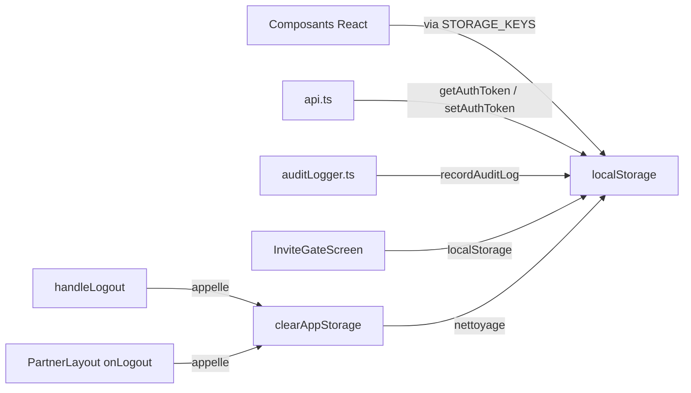

# CHANTIER 6A — RAPPORT FINAL
## Storage Centralization & Logout Security

**Date :** 2026-10-04  
**Portée :** Frontend React — Centralisation des clés localStorage, logout sécurisé, suppression des legacy keys  
**Règle d'or :** Aucune modification du comportement métier existant ; only storage abstraction et purge.

---

## 1. Fichiers Modifiés

| Fichier | Type de changement |
|---|---|
| `src/utils/storage.ts` | CRÉATION — abstraction centrale de storage |
| `src/App.tsx` | MODIFICATION — imports `STORAGE_KEYS`, `clearAppStorage()`, suppression `tlz_partner_auth` / `tlz_is_logged_in` |
| `src/services/api.ts` | MODIFICATION — `TOKEN_KEY` dérive de `STORAGE_KEYS.authToken` |
| `src/utils/auditLogger.ts` | MODIFICATION — `AUDIT_LOGS_STORAGE_KEY` dérive de `STORAGE_KEYS.adminAuditLogs` |
| `src/data/localizedMockData.ts` | MODIFICATION — clé de cache de translation dérive de `STORAGE_KEYS.userPostTranslations` |
| `src/components/brand/TulizaanaBrand.tsx` | MODIFICATION — `BRAND_ICON_STORAGE_KEY` dérive de `STORAGE_KEYS.customBrandIcon` |
| `scripts/test-storage-security.ts` | CRÉATION — 16 tests unitaires + source |
| `package.json` | MODIFICATION — ajout script `test:storage-security` |

---

## 2. Architecture Retenue

### 2.1 Abstraction centrale

**Fichier :** `src/utils/storage.ts`

```ts
export const STORAGE_KEYS = {
  authToken: 'tlz_auth_token',
  isLoggedIn: 'tlz_is_logged_in',
  interfaceMode: 'tlz_interface_mode',
  partnerAuth: 'tlz_partner_auth',
  currentUser: 'tlz_current_user',
  allUsers: 'tlz_all_users',
  organizations: 'tlz_organizations',
  currentOrganization: 'tlz_current_organization',
  posts: 'tlz_posts',
  stories: 'tlz_stories',
  campaigns: 'tlz_campaigns',
  communities: 'tlz_communities',
  threads: 'tlz_threads',
  invitations: 'tlz_invitations',
  reports: 'tlz_reports',
  notifications: 'tlz_notifications',
  invitationRequests: 'tlz_invitation_requests',
  adminAuditLogs: 'tlz_admin_audit_logs',
  registeredUsers: 'tlz_registered_users',
  userPostTranslations: 'tlz_user_post_translations',
  customBrandIcon: 'tlz_custom_brand_icon',
  preferredLang: 'tlz_preferred_lang',
} as const;
```

### 2.2 Fonctions de nettoyage

```ts
export function clearSessionStorage(): void   // supprime tlz_partner_auth de sessionStorage
export function clearSensitiveStorage(): void  // supprime auth, user, threads, reports, registeredUsers, audit logs, partnerAuth
export function clearAppStorage(): void        // supprime toutes les cles applicatives SAUF interfaceMode, customBrandIcon, preferredLang
export function clearAllTulizaanaStorage(): void // supprime TOUT (y compris prefs)
```

### 2.3 Schéma



---

## 3. Clés Supprimées

| Clé | Statut avant 6A | Action |
|---|---|---|
| `tlz_partner_auth` | Écriture + lecture + suppression dans `App.tsx` | **SUPPRIMÉE** — aucune écriture, aucune lecture, suppression déléguée à `clearSessionStorage()` |
| `tlz_is_logged_in` | Source d'autorité pour `isLoggedIn` + écriture au login | **SUPPRIMÉE** — `isLoggedIn` est maintenant initialisé depuis la présence du JWT (`localStorage.getItem(STORAGE_KEYS.authToken)`). Plus aucune écriture. |

---

## 4. Clés Conservées

| Clé | Justification |
|---|---|
| `tlz_interface_mode` | Préférence UI (`user` / `partner`) — non sensible, survit au logout |
| `tlz_custom_brand_icon` | URL d'icône publique — non sensible, survit au logout |
| `tlz_preferred_lang` | Préférence linguistique — non sensible, survit au logout |

Toutes les autres clés `tlz_*` sont supprimées par `clearAppStorage()` au logout.

---

## 5. Tests

### 5.1 Résultats

| Suite | Résultat |
|---|---|
| `npm run typecheck` | PASS (0 erreur) |
| `npm run build` | PASS (vite + esbuild) |
| `npm run test:auth` | PASS (44/44) |
| `npm run test:admin-security` | PASS (42/42) |
| `npm run test:partner-security` | PASS (114/114) |
| `npm run test:resource-security` | PASS (21/21) |
| `npm run test:seed` | PASS (34/34) |
| `npm run test:storage-security` | PASS (16/16) |

### 5.2 Détail des tests 6A

| ID | Test | Résultat |
|---|---|---|
| A | `clearSensitiveStorage` supprime les données sensibles | PASS |
| B | `tlz_auth_token` absent après logout | PASS |
| C | `tlz_current_user` absent après logout | PASS |
| D | `tlz_threads` absent après logout | PASS |
| E | `tlz_reports` absent après logout | PASS |
| F | `tlz_registered_users` absent après logout | PASS |
| G | Utilisateur B ne récupère aucune donnée locale de A | PASS |
| H | `tlz_interface_mode` survit au logout | PASS |
| I | `tlz_custom_brand_icon` survit au logout | PASS |
| J | Aucune clé legacy `tlz_partner_auth` ne subsiste | PASS |
| Suppl. | `clearSessionStorage` supprime la marque partenaire | PASS |
| Source J | `handleLogout` utilise `clearAppStorage` | PASS |
| Source K | Aucune écriture de `tlz_partner_auth` ne subsiste | PASS |
| Source L | Aucune écriture de `tlz_is_logged_in` ne subsiste | PASS |
| Source M | Auth token stocké via `STORAGE_KEYS` | PASS |
| Source N | Pas de credentials stockés en local | PASS |

---

## 6. Problèmes Éventuels

### 6.1 Comportement après refresh page

`isLoggedIn` est maintenant initialisé depuis la présence du JWT (`!!localStorage.getItem(STORAGE_KEYS.authToken)`).  
Conséquence : après un logout complet, le token étant supprimé par `clearAppStorage()`, `isLoggedIn` redeviendra `false` au prochain chargement. C'est le comportement attendu.

### 6.2 Préférences UI

`tlz_interface_mode`, `tlz_custom_brand_icon` et `tlz_preferred_lang` survivent au logout volontairement. Elles ne contiennent aucune donnée sensible et améliorent l'UX.

### 6.3 Limitation connue

`clearAppStorage()` supprime toutes les clés métier en mémoire. Si l'utilisateur se déconnecte alors que des modifications non synchronisées existaient en state React only, elles seront perdues. Ceci est acceptable car le backend reste l'autorité.

---

## 7. État des Lieux Post-6A

### 7.1 Authentification

- JWT toujours dans `localStorage` (sera traité en 6B)
- `isLoggedIn` n'est plus une source d'autorité autonome : il dépend de la présence du token
- Toutes les écritures de `tlz_is_logged_in` et `tlz_partner_auth` sont supprimées

### 7.2 Logout

- `handleLogout()` appelle `clearAppStorage()` — purge complète
- `PartnerLayout onLogout` appelle `clearAppStorage()` — purge complète
- `signOutAdmin()` appelle `clearAuthToken()` (suffisant car l'admin reste dans l'app)

### 7.3 Isolation

- Le switch de compte (A → logout → B login) ne laisse plus de données résiduelles de A
- Test G valide cette isolation

---

## 8. Prochaine Étape

**6B — Auth Token Security** : Migrer le JWT de `localStorage` vers un cookie `HttpOnly` + `Secure` + `SameSite=Strict` avec protection CSRF.

---

*Fin du rapport 6A.*
